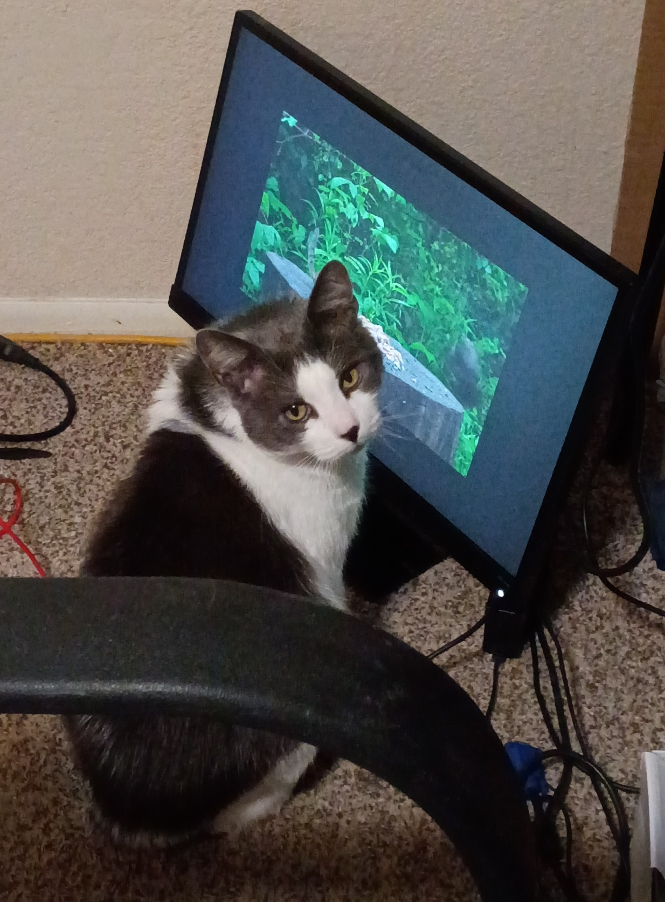
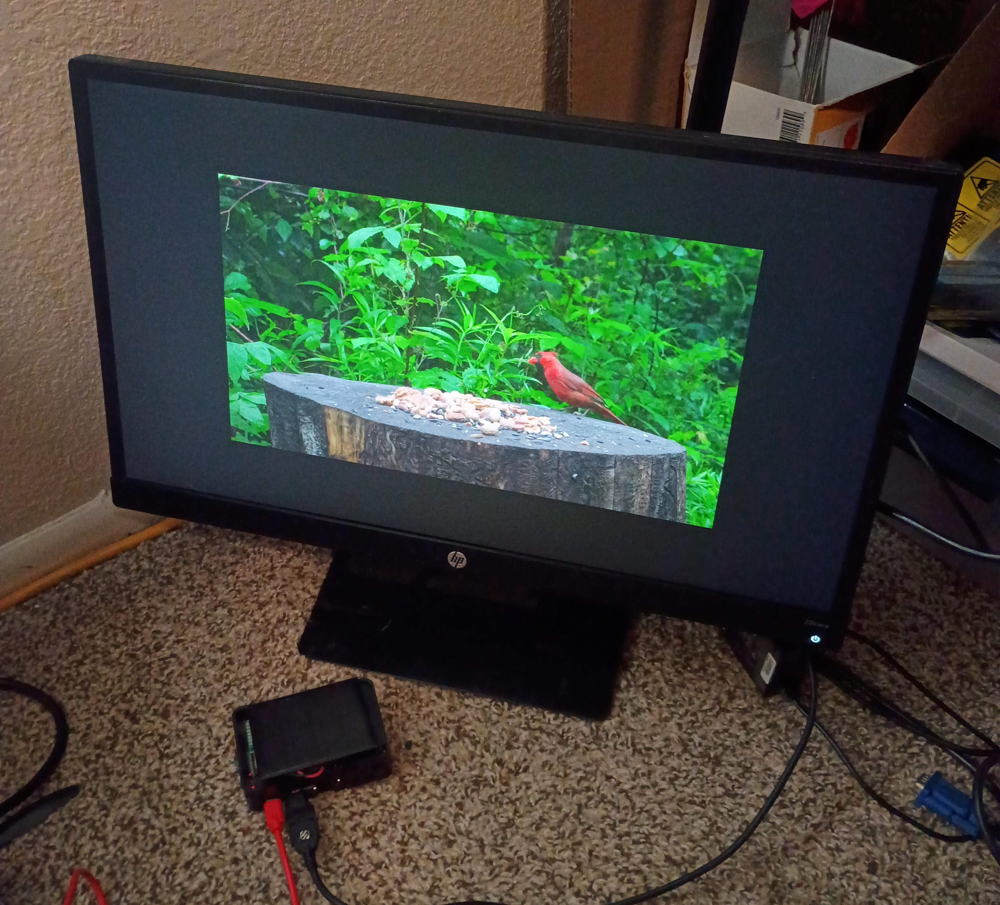

# Auto Video Player

This is setup on a headless raspberry pi (as a local server). It's headless so it's not an open desktop with accessible keyboard. It's installed in my own apartment but yeah.

This uses Openbox with Chromium browser to play .mp4 video files of birds.

The software knows how long the video is so when it's done playing will play another one and you set a schedule up when to play.

# Requirements

- preferrably a full-sized RPi
- an HDMI display connected to the RPi
- local .mp4 videos

# Setup

- run `$chmod +x install-deps.sh`
- run `$chmod +x openbox`
- run `$chmod +x run.py`
- run `$./install-deps.sh`

# Test

- run `$sudo xinit ./openbox`

# Persistence

In order for this service to run with the terminal closed you'll need something to run it like a daemon.

I've used systemd before that's usually what I use.

See the [markdown file](./systemd.md) on creating a systemd service unit

# Troubleshooting

If you just see a blank screen, you can use the `click.sh` script which uses `xdotool` to trigger a click event. This will show a popup window with the error of why openbox didn't wrk.

- `$sudo apt update && sudo apt install -y xdotool`
- `$chmod +x click.sh`
- ssh into the Pi in a 2nd terminal
- run the test command above in SSH terminal #1
- run the click command `$./click.sh` in terminal #2

